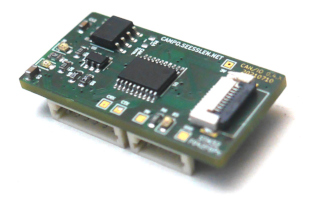

# TCBuilder3

<div align="center" width="100%" style="vertical-align: middle;" valign="middle">
    
</div>

## Overview

TCBuilder3 is a Makefile based skeleton for building a GCC-toolchain for STM32 
microsontrollers. The toolchain has multilib support to work with different
target arm architectures (32-bit only).

* GCC 16.2.0
* binutils 2.47
* OpenOCD 0.12.0
* Picolibc 1.8.12

## Building toolchain

### Prerequisite

An debian based host system is required.
Debian Bullseye is not supported (GLibc 2.43 needs GCC>= 12.2). Use at least Bookworm.
```
sudo apt install build-essential wget flex
```

### Run

As default the target directory for downloads is "~/tcbuilder3-downloads" and 
the build/work directory is "~/tcbuilder3-<TCB-Version>".

```
./make_stm32.sh
```


## Installing toolchain

### Prerequisite

An debian based host system is required.
```
sudo apt install bzip2 file
```

### install
Copy the archive to an directory of you chioce; e.g. /opt/
```
tar -xjf tcbuilder3-stm32-x86_64-3.*.tbz
cd tcb-3.*-stm32-x86_64
./relocate.sh
```

### Run

As default the target directory for downloads is "~/tcbuilder3-downloads" and 
the build/work directory is "~/tcbuilder3-<TCB-Version>".

```
./make_stm32.sh
```

